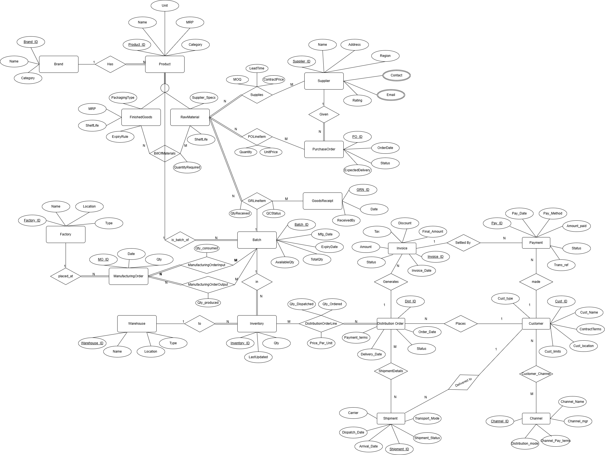
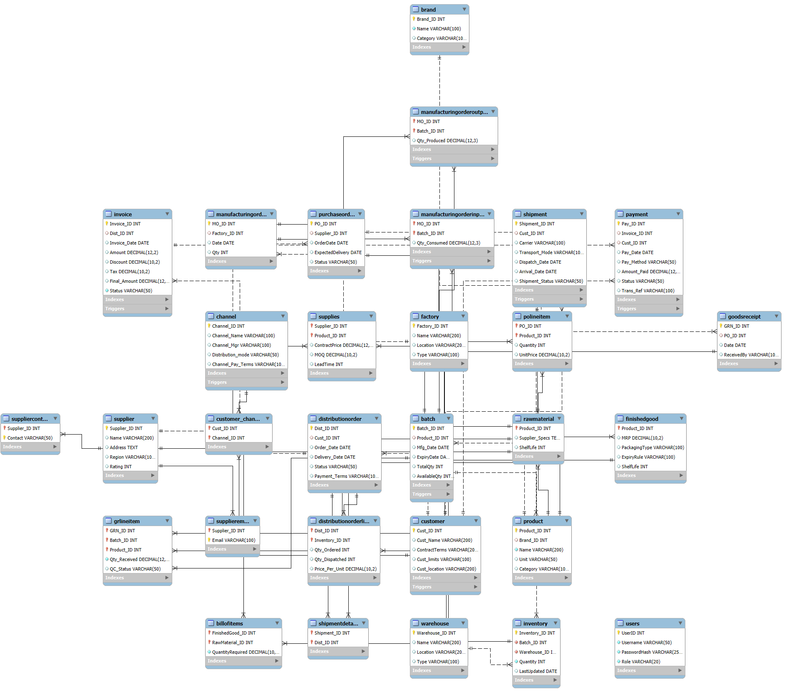

# HUL Supply Chain Intelligence Platform

A full-stack supply chain management system for FMCG operations, built for Hindustan Unilever Limited (HUL). The system covers the complete supply chain lifecycle — procurement, manufacturing, inventory, distribution, and finance — with ML-based demand forecasting and a conversational AI interface for natural language querying.

---

## Features

### Core Supply Chain Dashboard

- **Order Triage** — view pending and blocked orders with live stock status, allocate or cancel orders
- **Inventory Management** — real-time stock levels with expiry tracking across warehouse batches
- **Procurement** — raise and track purchase orders, manage supplier relationships
- **Finance** — invoice tracking, partial payment support, overdue customer alerts
- **Role-based access** — admin and warehouse roles with separate views and permissions

### Demand Forecasting (ML)

- Trained one **Meta Prophet** model per finished good on 2.5 years of historical distribution data
- Captures yearly seasonality (winter peaks for beverages and soups), growth trend, and anomalies
- Achieves **22–32% MAPE** — within industry standard for FMCG demand forecasting
- Interactive **Plotly.js chart** with historical actuals, forecast line, and 80% confidence band
- Suggests purchase order quantities based on forecasted demand minus current inventory

### Conversational AI Agent (LangChain + Groq)

- **ReAct agent** built with LangChain, powered by Llama 3.3 70B via Groq API
- **SQLDatabaseChain** for open-ended natural language queries against the live database
- **Stored procedure tools** for reliable known operations (pending orders, inventory, forecasts)
- **Write operations** (stock allocation, payment recording) via existing stored procedures — all DB constraints and triggers enforced
- **Conversation memory** — remembers last 6 exchanges per user session
- Floating chat panel accessible from any dashboard tab

### Database Engineering

- 24-table MySQL schema with full lot traceability (raw material batch → finished good)
- **13 triggers** — stock deduction on manufacturing, expiry auto-calculation, invoice status automation, payment validation
- **14 stored procedures** — stock allocation with race condition guards, partial payment tracking, order triage
- Business logic enforced entirely at the database layer — application layer cannot corrupt data

---

## ER Diagram

### Conceptual ER Diagram



### Physical Schema (MySQL Workbench)



---

## Tech Stack

| Layer          | Technology                                |
| -------------- | ----------------------------------------- |
| Backend        | Python 3.x, Flask                         |
| Database       | MySQL                                     |
| ML Forecasting | Meta Prophet, pandas, scikit-learn        |
| AI Agent       | LangChain 0.3.7, Groq API (Llama 3.3 70B) |
| Frontend       | Tailwind CSS, Plotly.js, Vanilla JS       |
| Auth           | bcrypt, Flask sessions                    |

---

## Project Structure

```
HUL-db-project/
├── application/
│   ├── app.py                  # Flask API — all routes
│   ├── static/
│   │   └── dashboard.js        # Frontend logic
│   └── templates/
│       ├── index.html          # Main dashboard
│       └── login.html          # Login page
├── forecasting/
│   ├── data_prep.py            # DB → Prophet-format DataFrames
│   ├── train.py                # Model training + evaluation
│   ├── forecast.py             # Forecast serving (called by Flask)
│   └── models/                 # Saved .pkl model files (gitignored)
├── chatbot/
│   ├── tools.py                # Stored procedures as LangChain tools
│   └── agent.py                # ReAct agent setup + memory
├── database/
│   ├── hul_db_setup.sql              # Schema + seed data
│   ├── hul_supply_chain_data_2023.sql # Synthetic historical data
│   ├── hul_supply_chain_data_2024.sql
│   ├── hul_supply_chain_data_2025.sql
│   ├── hul_db_afterSetup.sql         # Post-data constraints
│   ├── hul_db_procedures_functions.sql
│   ├── hul_db_triggers.sql
│   └── hul_db_users.sql
├── create_users.py             # Bcrypt user setup script
├── requirements.txt
└── .env                        # Not committed — see setup below
```

---

## Setup

### Prerequisites

- Python 3.10+
- MySQL 8.0+
- A [Groq API key](https://console.groq.com) (free)

### 1. Clone and activate virtual environment

```bash
git clone https://github.com/cashcheese/HUL-db-project.git
cd HUL-db-project

# Windows
.\application\venv\Scripts\Activate.ps1

# Mac/Linux
source application/venv/bin/activate
```

### 2. Install dependencies

```bash
pip install -r requirements.txt
```

### 3. Create `.env` file in the project root

```env
FLASK_SECRET_KEY=your_secret_key_here
DB_HOST=localhost
DB_USER=your_mysql_username
DB_PASSWORD=your_mysql_password
DB_NAME=hul_db
GROQ_API_KEY=your_groq_api_key_here
```

### 4. Initialize the database

Open MySQL and run the scripts in this exact order:

```bash
mysql -u root -p

source database/hul_db_setup.sql;
source database/hul_supply_chain_data_2023.sql;
source database/hul_supply_chain_data_2024.sql;
source database/hul_supply_chain_data_2025.sql;
source database/hul_db_afterSetup.sql;
source database/hul_db_users.sql;
source database/hul_db_procedures_functions.sql;
source database/hul_db_triggers.sql;
```

### 5. Create application users

```bash
python create_users.py
```

Default credentials:
| Username | Password | Role |
|---|---|---|
| admin | admin | admin |
| warehouse_user | warehouse | warehouse |

### 6. Train the forecasting models

From the project root:

```bash
python -m forecasting.train
```

This trains one Prophet model per finished good and saves `.pkl` files to `forecasting/models/`. You should see MAPE metrics printed for each product.

### 7. Run the application

```bash
cd application
python app.py
```

Open [http://localhost:5000](http://localhost:5000)

---

## API Reference

### Auth

| Method | Endpoint                 | Description      |
| ------ | ------------------------ | ---------------- |
| POST   | `/api/auth/login`        | Login            |
| POST   | `/api/auth/logout`       | Logout           |
| GET    | `/api/auth/current-user` | Get session user |

### Dashboard

| Method | Endpoint                  | Description              |
| ------ | ------------------------- | ------------------------ |
| GET    | `/api/orders/pending`     | Pending + blocked orders |
| GET    | `/api/inventory/snapshot` | Current stock levels     |
| GET    | `/api/customers/overdue`  | Overdue invoices (admin) |

### Forecasting

| Method | Endpoint                                  | Description                |
| ------ | ----------------------------------------- | -------------------------- |
| GET    | `/api/forecast/<product_id>?horizon=90`   | Full forecast + historical |
| GET    | `/api/forecast/suggested-po/<product_id>` | Suggested PO quantity      |
| GET    | `/api/forecast/all`                       | All products summary       |

### Chatbot

| Method | Endpoint          | Description               |
| ------ | ----------------- | ------------------------- |
| POST   | `/api/chat`       | Send message to AI agent  |
| POST   | `/api/chat/clear` | Clear conversation memory |

### Orders (admin)

| Method | Endpoint                  | Description              |
| ------ | ------------------------- | ------------------------ |
| POST   | `/api/orders/allocate`    | Allocate stock for order |
| POST   | `/api/orders/deallocate`  | Reverse allocation       |
| POST   | `/api/orders/cancel`      | Cancel processing order  |
| POST   | `/api/orders/generate-po` | Raise PO for shortfall   |

### Finance (admin)

| Method | Endpoint                       | Description     |
| ------ | ------------------------------ | --------------- |
| GET    | `/api/finance/invoices`        | Unpaid invoices |
| POST   | `/api/finance/payments`        | Record payment  |
| GET    | `/api/finance/payment-history` | All payments    |

---

## Example Chatbot Queries

```
"What is the current inventory?"
"Which orders are blocked and why?"
"What is the demand forecast for Bru Coffee?"
"Which customer has placed the most orders?"
"Are there any overdue invoices?"
"What products are running low on stock and what is their forecast?"
```

---

## Notes

- The AI agent uses a ReAct loop — it reasons step by step, picks the right tool, and synthesizes a natural language answer
- Write operations (stock allocation, payments) go through existing stored procedures — the agent cannot bypass database constraints
- Forecasting models must be retrained (`python -m forecasting.train`) if new historical data is added
- The `forecasting/models/` directory is gitignored — run the training script after cloning
